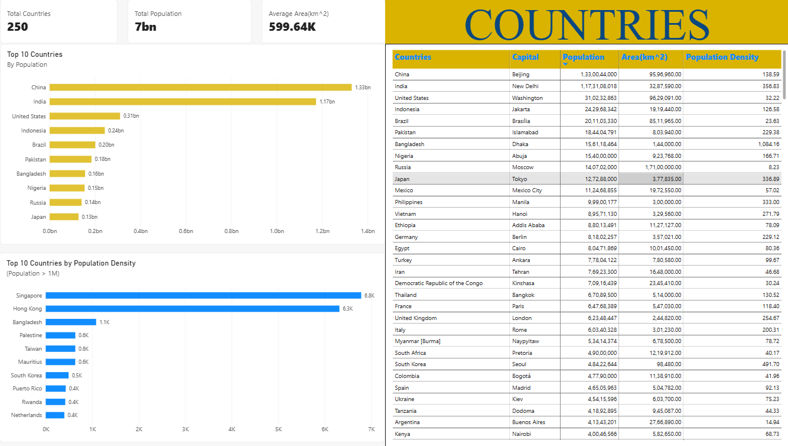

# Country Data Scraper & Power BI Dashboard

Scraped data for 250 countries from a practice website using Python, cleaned it, and built an interactive Power BI dashboard.

## Tools
Python, Requests, Beautiful Soup, CSV, Power BI

## What it does
1. Scrapes country name, capital, population and area with Requests + Beautiful Soup
2. Saves the data to `countries.csv`
3. Dashboard (Power BI): KPI cards, Top 10 by population, Top 10 by population density (countries over 1M people), and a searchable table
4. Added a calculated column: Population Density = Population / Area

## Dashboard

## How to run
pip install -r requirements.txt
python scraper.py

## Files
- `scraper.py`: scraping script
- `countries.csv`: scraped data
- `countries_dashboard.pbix`: Power BI file
